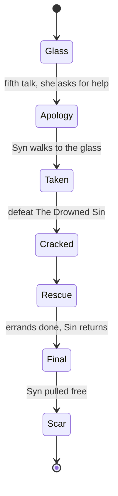

# Drowned Saint secret quest

The approach already exists in two places. Syn’s wedding in [`lib/engine/quests.rb`](lib/engine/quests.rb) is a hidden, once-per-delver chain that never appears on Berry’s board. Covar’s dress counsel in [`lib/engine/boss_fights.rb`](lib/engine/boss_fights.rb) (`relic_assignment` / `dress_counsel_blocks_relic?`) is the pattern for forcing who stands on a boss floor. The Saint herself is a relic, not a floor lord: from cycle 2 she can replace a clergy boss on floors 5–30, and she currently has no Talk button and no per-boss kill count.

Do not put this on `/quests`. Do not add her to the clergy Talk tree in [`lib/engine/conversations.rb`](lib/engine/conversations.rb). A dedicated victory button, the same shape as “Ask about the dress” in [`commands/combat.rb`](commands/combat.rb), keeps the slow approach a secret.

## Story shape

She never explains what she is. The codex already refuses to settle her origin (a drowned god, a piece of Eros, or a saint who drowned praying). This quest must not “solve” that. What she wants is the story: she believes, or tells herself, that she and Syn together would be the perfect vessel for Eros. The apology is the lie the player is allowed to believe. Eros, afterward, is not confused about what happened.

**Glass (specified).** A hidden counter, not a quest log. Each new victory over the Drowned Saint offers one Talk press. The press shows the next line and only then advances, so farming her without pressing cannot skip ahead. Satisfy counts as a meeting: she was worshipped, which matches her existing closing line (“Tell her that her saint was worshipped”). The line is still the same five:

1. “Seems she won’t talk to you.”
2. “She looks at you from behind the glass.”
3. “She leans against the glass watching you...”
4. “It looks like she might want to talk to you next time...”
5. She speaks. She asks for help.

**The fifth talk plants the lie.** She says Syn flinches when the tank is near. She wants to go up once, say she is sorry for scaring her, and be seen as something other than the thing in the water. She never says “vessel.” She asks the delver not to use her name.

**Part 1, three errands, then the taking.** Short on purpose. The length is the glass, not a second wedding board.

- Speak with Syn afterward (opening her Talk from the parlour sets the flag). The Saint told you to let Syn see a gentle face.
- Clear one boss threshold without satisfying them, counted from a baseline the way `claim_story!` baselines the next wedding step. “Show her the tower can be walked through, not only worshipped.”
- A new Syn topic, unlocked only now: “Someone below wants to apologize.” Syn agrees to come to the next threshold. If the delver wears five of her marks or has finished the vow renewal, she comes because she trusts them. Otherwise she comes wary, as a courtesy. Same destination, different scene.

The next boss floor (5–30) is forced to be the Drowned Saint, ignoring the 30% relic roll. You fight her as usual. Talk plays the meeting: the apology, Syn stepping to the glass, the glass opening, Syn taken. Part 1 ends. No trophy change, no codex spoiler.

**Grief, and Part 2 starts by itself.** Everyone who loved Syn knows the delver walked her there. Eros is the worst of them. She does not shout on every screen; she is cold, precise, and done being fond.

**The Drowned Sin** is a new relic key, not a rename of the Saint. Same tank, same host-floor stats, worse. While the hunt is on, the next boss floor you actually reach is her, every time, until she is defeated for real.

- Submitting or satisfying her thanks you and pulls Syn deeper. The quest does not advance. She is waiting on the next boss floor again.
- A real defeat cracks the glass. You hear Syn. The Sin does not die. Rescue starts.

**Rescue, three errands, then the pull.**

- Berry will not ink. One button on the empty bench: she lets you take Syn’s needle while she tells you what you are.
- Vex, who Syn made, gives a thread. She is not kind about the asking.
- Floor 35 still happens. Eros will not hand over anything for the delver. Defeat or satisfy her while Syn is gone and she shakes loose a warmth “for the fairy, not for you.”

The Sin returns on the next boss floor. The victory scene is the rescue: the needle, the thread, and that warmth crack the tank, and Syn is pulled out. The Saint is not deleted from the game. She can appear again later as the relic she always was. The quest does not repeat.

**Scars, not a snap back.** For a while after the return, Syn is quieter, Berry’s first line is not a joke, and Eros stays cold. Then the tower goes back to normal except a few permanent lines: Eros remembers, Berry remembers, Syn does not tell the story on her own. How bad the permanent lines are depends on trust. Five marks or a finished wedding means Syn said “I trust you” on the way to the glass, and Eros cites that. A stranger’s abduction is uglier in the moment and blamed more on the Saint afterward.

## How it stays dynamic without a novel in every file

One tracker, `syn_taken`, is the switch. Panels check it. They do not each grow a copy of the plot.

- **Parlour** ([`commands/parlour.rb`](commands/parlour.rb)): Berry alone. Marks still work, so the bench is not a soft lock. The wedding chain freezes until Syn is back; progress is kept.
- **Curse ledger** ([`commands/curses.rb`](commands/curses.rb)): view only. See Eros's wrath below. The voice is Berry, who will not cut a blessing off you and will not smother one either.
- **Talk:** the Syn button becomes the empty stool. Berry, Vex, Pip, and Eros get a handful of grief topics. Existing `syn:` strings stay in the catalog and are simply not reachable while she is gone. New lines written later call one helper, `SaintQuest.syn_gone?(player)`, instead of copying paragraphs.
- **Eros:** extra lines in `eros_regard_lines`, not a replacement of her whole intro. The stock throne text stays. The anger is added the way marks and the Syn Fae form already add lines.

“Every line in the tower” as a literal rewrite will rot (seasons, codex, resident chains, holiday crumbs). The grief state covers every panel a delver actually uses to find Syn, plus Eros. Lore quotes inside other people’s old topics can wait for the scar pass.

## Eros's wrath

This lasts only while `syn_taken` is set. The scar period after Syn is pulled free does not keep it. Getting her back does not put the ink back on and does not remember which curses were smothered.

**Every suppressed curse wakes, for free, the moment she is taken.** Call the existing `Player#reactivate_suppressed_curses!` (the same wake defeat already uses). No LP refund, because they already paid to smother them. Curses gained while she is gone land active, the way curses always land.

**Suppress and remove are refused the whole time she is gone.** The ledger still opens, so they can read what is awake on them. Suppress, Remove, Remove ALL, and Unsuppress do not appear. `e,removecurse`, `e,suppresscurse`, `/removecurse`, and `/suppresscurse` in [`commands/removecurse.rb`](commands/removecurse.rb) refuse with Berry's line before they spend LP. Living-gear tear-off is not a curse and still works.

**Threat is locked at the ceiling.** Threat is not a stored stat. [`ThreatCalculator#calculate`](lib/engine/threat_calculator.rb) builds it from LP, active curses, and worn appearance, then caps the result at 100. While she is gone, that method returns 100% and category `:high` immediately, and the stat, lust, and encounter multipliers are the ones 100% already produces (about ×1.60 power and ×1.90 lust). Combat, stairs, encounter weights, and the status readout all call this one method, so the lock does not need a second path.

The status line stops showing the LP / curse / appearance breakdown and says the tower is at the ceiling because Eros is angry. One honest side effect: high threat already makes shops 10% cheaper and LP gains 10% higher, because those read the same category. The lock includes them. The punishment is the fights and the stairs.

## Trackers

All of these go in `CHARACTER_STORY_TRACKERS` in [`lib/models/player.rb`](lib/models/player.rb), beside the wedding keys. They survive defeat and clear on `/restart`.

- `drowned_saint_defeats` — bumped in `finish_victory!` when the encounter name is Drowned Saint
- `saint_glass_step` — 0 to 5, advances only when Talk is pressed, and only if defeats is greater than the step
- `saint_quest_step` / `saint_quest_start` — part 1, then rescue, baselined like the wedding
- `syn_taken` — 0/1
- `saint_quest_done` — rescue finished; glass and part 1 never offer again

No status row. No help text. The codex fragment stays the one that already exists.

## Forcing her to appear

[`relic_assignment`](lib/engine/boss_fights.rb) returns early for cycle 1, floor 35, a saved roll, and the dress-counsel block. Death sets the cycle back to 1, which would hide a relic completely. The hunt has to win over all of that except floor 35 and the dress-counsel floors (10 and 25 stay Queen and Lich if Covar still needs them; the Sin waits for the next legal floor).

- Part 1 meeting: force `drowned_saint` once.
- Part 2: force a new `drowned_sin` entry in `RELICS` until a non-satisfy victory, then again for the final fight.
- Write the assignment even if that floor already saved `"none"` this cycle, or the player can lock her out by walking onto the floor before the quest flips.

## Build order

The first slice is only the glass. The quest module exists so later steps drop in without another rewrite. Copy stays placeholder-quality until you rewrite it; the five glass lines you wrote are the real ones.

1. New [`lib/engine/saint_quest.rb`](lib/engine/saint_quest.rb): step helpers, the five lines, and empty hooks for part 1, grief, and rescue.
2. Bump `drowned_saint_defeats` from boss victory in [`lib/engine/combat_engine.rb`](lib/engine/combat_engine.rb).
3. Talk button on her victory panel only, custom id `eros:saint:glass:USER`, handled like the dress button. One message, then the panel stays. No topic menu.
4. After that is in and you have played the five lines, write part 1’s three errands and the taking scene, then `syn_taken` on parlour and talk. The taking scene also wakes every suppressed curse, locks suppress and remove, and forces threat to 100% until Syn is back.
5. Add The Drowned Sin and the force-spawn, then the rescue errands and the scar lines.

Changelogs (`CHANGELOG.md`, and `DISCORD_CHANGELOG.md` only for what a delver can actually notice) land with each slice. The glass slice is invisible until someone has beaten her, so the Discord paste can wait until part 1 is something a delver can find on purpose. The secret itself should not be announced.
