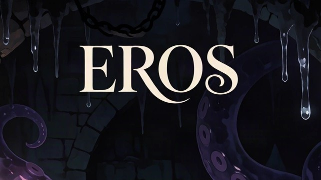

# Endless Ruins of Sin

A text-based dark-fantasy **NSFW** Discord roguelike. You descend a lust-soaked tower of rooms, traps, monsters, and domain lords toward **Eros, Goddess of Lust**, on floor 35.

**If you are under 18, leave.** Content options only filter *which* adult themes appear — they do not make the game safe for work.

## The climb in brief

| Idea | What it means for you |
| --- | --- |
| **Explore** | `/explore` opens the next room: monster, trap, treasure, event, stairs, altar, or something stranger |
| **Combat** | Fight, Flee, or Submit. Lust builds; climax drains **Defiance**. At 0 Defiance you break |
| **Lust Points (LP)** | Earn them, spend them on levels, gear, curses, marks, and more. They also raise **Threat** |
| **Persist** | LP, curses, living gear, marks, titles, and long progress survive defeat. Ordinary shop gear usually does not |
| **Clear** | Beat or satisfy Eros → a harder **cycle** with better payouts |
| **Choose** | `/options` — pick your themes; the tower stays adult |

## Who waits on the way up

| Floor | Presence |
| --- | --- |
| 5 | Mimic Broodmother |
| 10 | Succubus Queen |
| 15 | Incubus King |
| 20 | Verdant Dryad |
| 25 | Lich Lord |
| 30 | Alpha Beast |
| 35 | Eros |

Between climbs you’ll meet **Syn** and **Berry** (parlour, shop, quests), **Covar** (living gear), and settled residents like **Madame Vex**, **Pip**, **Sister Nectar**, and the **Pale Cartographer**.

→ [How to play](Gameplay/Overview.md) · [Commands](Commands.md) · [Equipment](Systems/Equipment.md) · [Living gear](Systems/Living-Gear.md) · [Marks](Systems/Marks.md) · [Curses](Systems/Curses.md) · [Titles](Systems/Titles.md) · [Achievements](Systems/Achievements.md) · [Transformations](Systems/Transformation.md) · [People](People/Index.md) · [Calendar](Calendar/Index.md)
